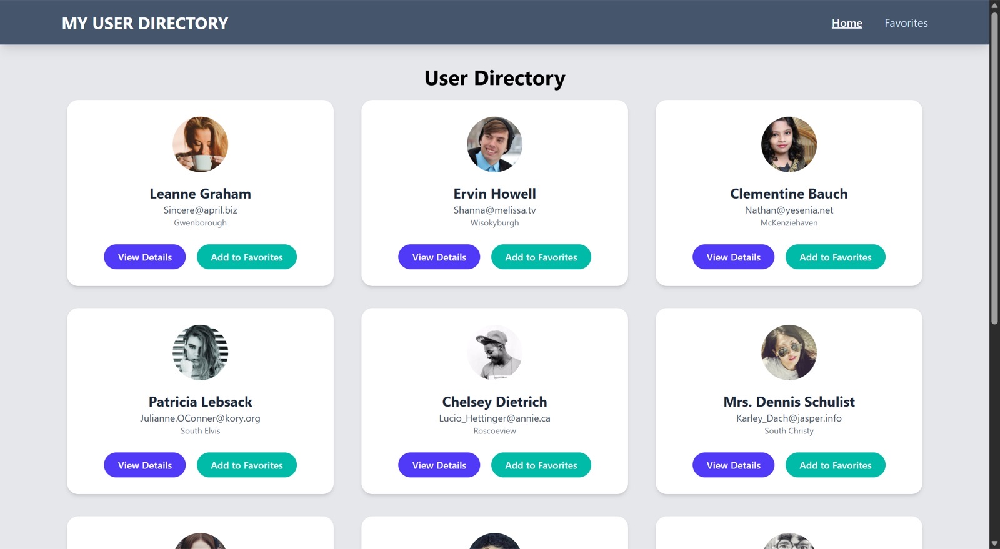

<div align="center">

# 👥 User Directory

A user directory with detail pages and favorites, using the JSONPlaceholder API.

<a href="https://miladmo68.github.io/User-Directory/"></a>
<a href="https://github.com/miladmo68/User-Directory"></a>
<a href="https://miladweb.com"></a>

**🔗 Live:** [miladmo68.github.io/User-Directory](https://miladmo68.github.io/User-Directory/)

</div>

<p align="center">
  
</p>

## ✨ Features

- List users from an API
- User details page
- Add users to favorites
- Context API and React Router

## 🛠️ Tech Stack

     

## 🚀 Getting Started

**Prerequisites:** [Node.js](https://nodejs.org/) 18 or newer

**Install and run**

```bash
git clone https://github.com/miladmo68/User-Directory.git
cd User-Directory
npm install
npm run dev
```

## 📁 Project Structure

```
User-Directory/
├── src/
├── eslint.config.js
├── index.html
├── package.json
├── tailwind.config.js
└── vite.config.js
```

## 👤 Author

**Milad Mohammadi** — Frontend-Focused Full-Stack Developer, Toronto 🇨🇦

[](https://miladweb.com)
[](https://www.linkedin.com/in/miladmo68/)
[](https://github.com/miladmo68)

<p align="center"><sub>If you like this project, consider giving it a ⭐</sub></p>
